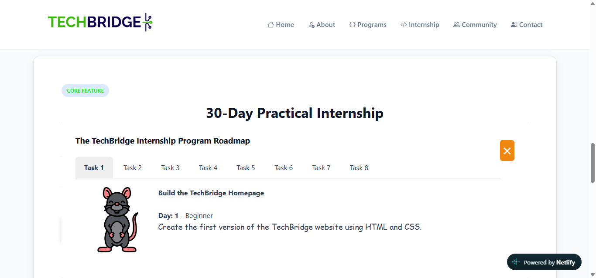

Viste the website at : https://techbridge-task-3.netlify.app/
To present the 8 TechBridge internship tasks, I designed a responsive tab grid where each tab highlights the task number,  difficulty level, and key deliverables. I chose a structured acordion tab design  so visitors can scan the entire 30-day curriculum at a glance while clearly seeing the step-by-step progression in difficulty. Through this task, I strengthened my understanding of CSS tab Grid and semantic HTML5 structuring across an SPA navigation. The main challenge I faced was ensuring tabs of varying text lengths maintained uniform height and spacing across tablet and mobile viewports, which I resolved using Flexbox column alignment inside each card.
